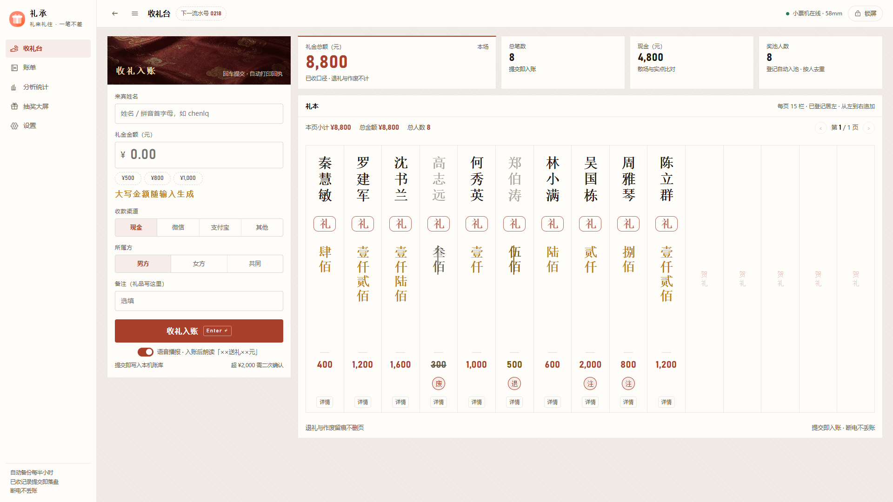
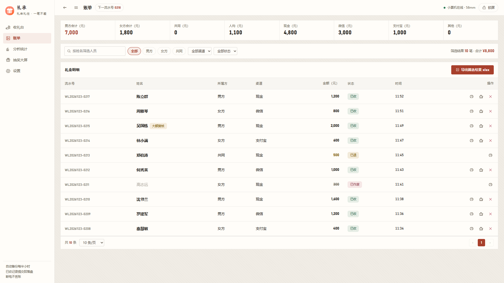
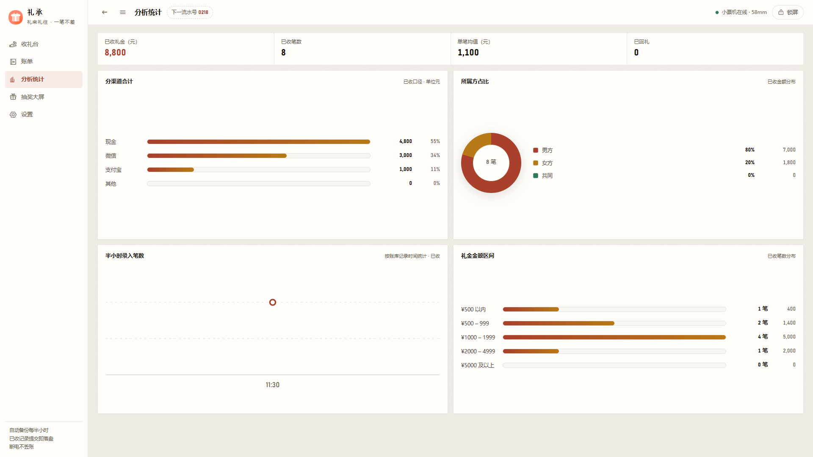
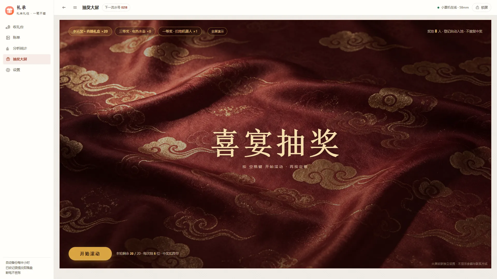

### 礼 承

**婚宴 · 寿宴 · 满月酒 — 现场收礼登记桌面软件**

礼来礼往 · 一笔不差

 

**🏮 官网：<https://www.licbook.cn/>**

---

## ✨ 为什么是礼承

门口一张桌、一台电脑，宾客递红包、写名字、给回执——这套流程里最容易出错的一环，礼承替你管住：

<table width="100%">
  <tr><th width="5%"></th><th width="20%">能力</th><th>说明</th></tr>
  <tr><td>🖊️</td><td><b>3 秒登记</b></td><td>拼音首字母检索、金额快捷档、大写金额实时生成，回车即入账</td></tr>
  <tr><td>🧾</td><td><b>回执即打即撕</b></td><td>58 / 80mm 热敏小票机即插即用，自动打印、补打留痕</td></tr>
  <tr><td>📚</td><td><b>多礼簿管理</b></td><td>男女方分簿、流水号前缀独立，每本自带管理密码与绸缎主题</td></tr>
  <tr><td>🎰</td><td><b>抽奖大屏</b></td><td>奖品池、滚动开奖、中奖名单留档，直接投屏热闹全场</td></tr>
  <tr><td>📊</td><td><b>分析统计</b></td><td>总额 / 笔数 / 渠道 / 归属，图表点击即可下钻到明细</td></tr>
  <tr><td>🔒</td><td><b>数据在本机</b></td><td>全程离线，SQLite 本地账库，每 10 分钟自动备份、保留 20 份</td></tr>
  <tr><td>🆓</td><td><b>完全免费</b></td><td>闭源软件、无需账号，所有功能永久可用</td></tr>
</table>

> 无网络也能完整运行——登记、打印、语音播报、大屏全部在本机完成。

## 🆓 免费使用

礼承是完全免费的闭源软件，**无需账号、没有任何使用限制**。下载安装后所有功能立即可用。

- 无需注册账号，无需联网，不上传任何数据。
- 忘记管理密码？建簿时生成的**恢复码**或**密保问题**可在本机自助重设，账目不丢失。

## 📸 界面一览

<table>
  <tr>
    <td align="center" width="25%"> <b>收礼台 · 3 秒登记</b></td>
    <td align="center" width="25%"> <b>名帖式礼簿</b></td>
    <td align="center" width="25%"> <b>分析统计</b></td>
    <td align="center" width="25%"> <b>抽奖大屏</b></td>
  </tr>
</table>

## 💝 打赏支持

礼承完全免费、所有功能永久可用。如果它帮到了你，欢迎微信扫一扫打赏，支持后续维护与更新。每一份心意，都是继续完善的动力。

## 🚀 下载

| 渠道 | 地址 |
|:---|:---|
| ⬇️ **安装包**（Windows 10/11 64 位） | <https://github.com/longsmao/longsmao.github.io/releases/latest> |

> 基于 Rust + Tauri 2 + WebView2 重构，安装包约 3.2 MB（旧版 Electron 约为 87 MB）。目标系统需 Windows 10 1809+ 或 Windows 11（内置 WebView2）。

## 🛠️ 技术栈

- **后端**：Rust + Tauri 2 + rusqlite（SQLite）
- **前端**：Vue 3 + Vite + Pinia + Vue Router
- **打印**：Win32 GDI 静默输出，支持 58/80mm 热敏小票
- **语音**：Webview2 speechSynthesis + Windows 离线中文音色
- **数据**：账库 `licheng.db` 跟随 exe 同目录（便携模式），每 10 分钟自动备份

**© 2026 longmao · 礼承 免费使用**

